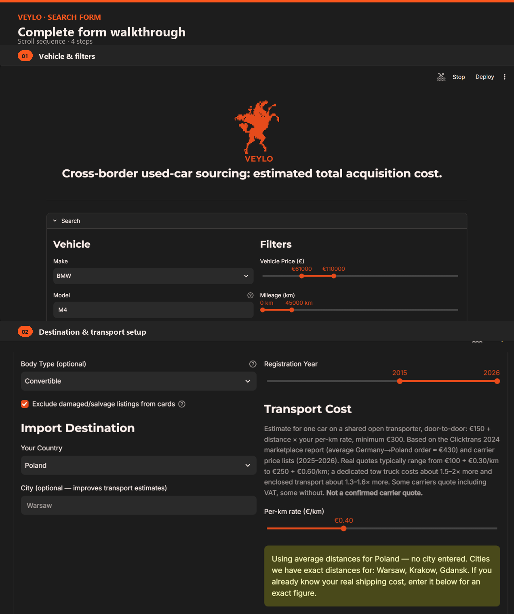
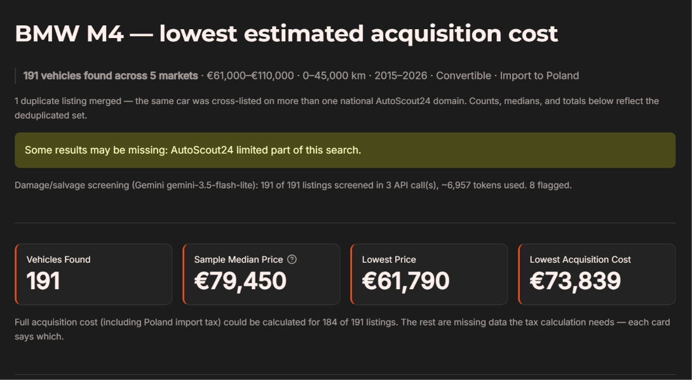
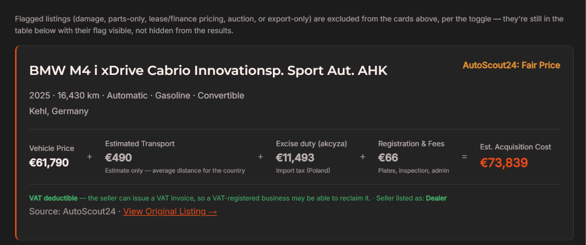
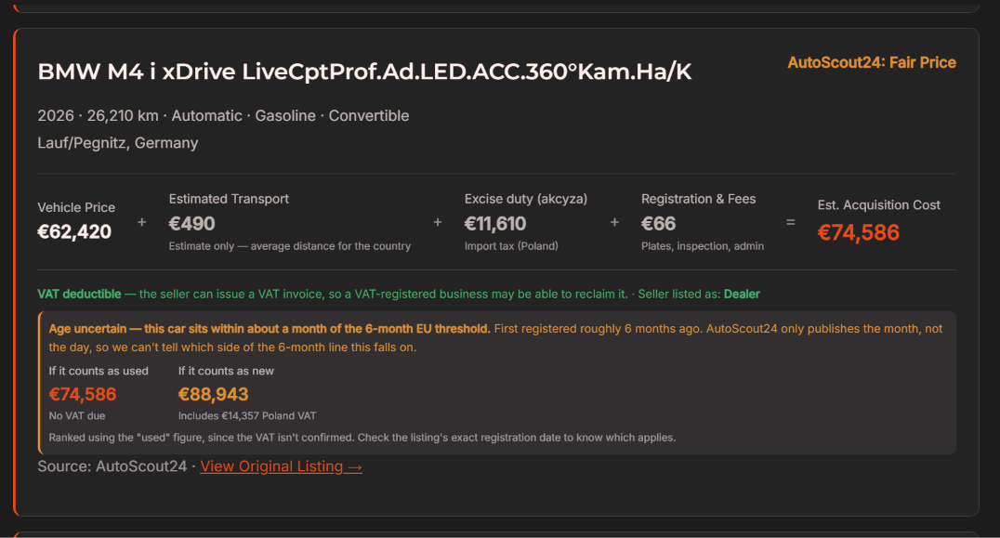

# Veylo — landed-cost estimator for cross-border used-car sourcing (prototype)

A working prototype that searches used cars across five European markets and estimates the total cost of importing each one into Poland, Romania, Bulgaria or the Czech Republic, with every number either sourced or explicitly marked unknown.

## Project status

Paused (prototype complete). I built this to test whether a landed-cost view could be a product for small car importers. The prototype showed it is technically feasible. Market research then showed three constraints: an established company launched the same calculation bundled with inspection, paperwork and transport; reliable data access depends on third-party scraping with unresolved terms of use; and my customer evidence was a single interview. I paused development rather than build further on an unproven edge.

## What it does

- Searches AutoScout24 listings for one make and model across Germany, Belgium, France, the Netherlands and Italy in a single search.
- Estimates, for each car, the cost of getting it registered in the chosen destination country: vehicle price + transport + the destination's tax + registration and inspection fees.
- Adds destination VAT when a car counts as "new" under EU rules (6 months old or less, or 6,000 km or less).
- When an input is missing (for example engine size), it shows "not calculated" and the reason. It does not fill in a guess.
- When the data supports two answers (for example a hybrid that may or may not be a plug-in), it shows both totals.
- Screens listing titles with an AI model for damage, parts-only, lease or finance prices, auctions and export-only prices, and flags them.
- Shows the 20 lowest-cost cars as cards, every other result in a sortable table, and a per-market comparison of sample medians.

## Run it locally

```bash
git clone https://github.com/Aymen20066/Veylo.git
cd Veylo
pip install -r requirements.txt
cp .env.example .env        # then add your own Apify and Gemini keys to .env
streamlit run app.py
```

You need your own [Apify](https://apify.com) token and [Gemini](https://aistudio.google.com) API key. Each live search costs a few cents of Apify credit. A live search takes several minutes, because each price range is fetched as a separate scraper run. No data is bundled with this repository: every result comes from a live search you run yourself.

## How it works

```
fetch → clean and re-verify filters → deduplicate → estimate costs → screen titles → rank
```

One line per module of `veylo/`:

- `config.py` — constants (markets, makes, distances, limits, screening categories) and environment loading.
- `retrieval.py` — splits the price range into bands, builds the AutoScout24 search URLs, starts, polls and fetches the Apify runs, and detects truncated bands.
- `transform.py` — re-applies the filters locally, removes duplicates, resolves each car's country and transport cost, adds the cost columns, ranks and splits results into cards and table, and formats the cards.
- `costs.py` — exchange rates, fuel and emission helpers, the four destination calculators, the EU new-vehicle VAT logic, and the single `calculate_import_costs` entry point.
- `screening.py` — sends listing titles to Gemini in batches and returns a category per listing, or "not screened" when a batch fails.

`app.py` contains only the Streamlit interface.

## Design decisions

**(a) Never invent a number.** Each calculator returns either a figure or an explicit reason why it could not be calculated. A missing value is never replaced with an average or with €0, because €0 reads as "no tax owed". When the data supports two answers, both totals are shown.

**(b) Price-band retrieval with truncation detection and local re-verification.** The scraper ignored filters in testing, so every filter (price, mileage, year, body type) is checked again locally after results come back. The price range is split into bands, each sorted cheapest first and capped separately, so a cap cuts only the expensive end of a band. A band that returns exactly its cap is reported as possibly truncated.

**(c) AI screening with a fixed answer format.** The model must answer with one of six fixed categories per title, enforced by a response schema and validated again in code. Titles are sent in batches sized to the measured rate limit. If a batch fails, its listings are shown as "not screened", never as clean.

**(d) Dropping my own deal score.** I first scored each car against the median of the search results. Because retrieval is cheapest-first, that sample was biased toward cheap cars and the score was misleading. I removed it and show AutoScout24's own price rating instead, labelled as theirs.

**(e) The test suite.** 134 tests cover the tax calculators, price bands, deduplication, truncation detection, the screening failure paths, HTML escaping of scraped text, credentials never appearing in a URL, and a headless run of the interface.

## What I learned

Technical:

- External data can't be trusted. Filters were silently ignored, documented values differed from real output, and fields were missing on a real share of listings.
- A cheapest-first sample can't describe a market. Medians from it are sample medians and are labelled that way.
- AI output needs a fixed format and a failure path.
- Measure costs before designing pricing. The measured cost per search was very different from my first assumption.

Commercial:

- Validate with several customers before building. One interview is not evidence of a market.
- A feature is not an edge if a calculator gives it away free.
- Tools that take no transaction risk are worth less to professionals than services that do.

## Known limitations

- Transport is estimated as a fixed €150 plus a per-km rate (default €0.40/km, minimum €300) over one average distance per country pair, calibrated on the Clicktrans 2024 marketplace report and carrier price lists. It ignores the car's exact location and assumes a shared open transporter.
- The tax tables have not been reviewed by a tax professional.
- Exchange rates are static: ECB reference rates as of 21 August 2026.
- The units of the Bulgarian eco-fee are unverified. The code treats the figures as EUR; the original project plan (docs/original-plan.md) records the same figures as BGN. If they are BGN, Bulgarian amounts are about twice too high.
- The market comparison table shows medians of the listings returned by one search, which are fetched cheapest-first; it is not a market price estimate.
- Listing data comes from scraping AutoScout24, whose terms may restrict automated collection. This is a non-commercial portfolio prototype and no scraped data is included.

## Screenshots



*Search: vehicle, filters, destination and a sourced transport estimate.*



*Results: summary and top listings by estimated acquisition cost.*



*One listing: vehicle price + transport + Polish excise duty + fees = estimated acquisition cost.*



*When the data supports two answers (here: whether the car still counts as new for VAT), Veylo shows both totals instead of guessing.*

## Running the tests

```bash
python -m pytest
```

## Disclaimer

All figures are estimates. Nothing here is tax or legal advice. Check any amount with the relevant authority or a qualified professional before acting on it.

## License

MIT — see [LICENSE](LICENSE).
